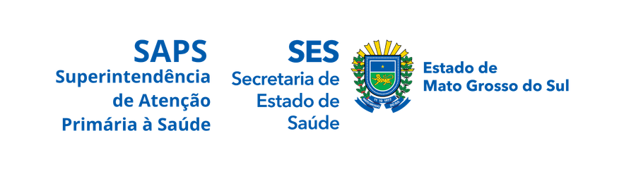

 

---

## 👨‍💻 Sobre mim

Desenvolvedor full-stack de **Campo Grande, MS**, focado em arquitetura limpa, performance e produtos que duram.
Trabalho do banco de dados à interface: APIs, painéis, apps desktop e sistemas para o setor público e privado.

- 🏢 Fundador da **[JELCH Group](https://jelchgroup.com)**
- 🏛️ Desenvolvo soluções para a **saúde pública** de MS ([SAPS](https://saps.saude.ms.gov.br))
- 🌱 Membro da **[DevHub Community](https://github.com/devhubcommunity)**
- 🧠 Estudando a fundo **C# / .NET** e **Rust**
- 🐳 Open source: criei o **AutoDock**, que leva qualquer projeto para o Docker em poucos cliques

---

## 🚀 Projetos em destaque

<table>
<tr>
<td align="center" width="33%" valign="middle">
 
<a href="https://dakiali.com">
  <picture>
    <source media="(prefers-color-scheme: dark)" srcset="assets/dakiali-logo-dark.svg" />
    
  </picture>
</a>
 
<a href="https://dakiali.com"><b>dakiali.com</b></a>
  
</td>
<td align="center" width="33%" valign="middle">
 

 
<a href="https://saps.saude.ms.gov.br"><b>saps.saude.ms.gov.br</b></a>
  
</td>
<td align="center" width="33%" valign="middle">
 

 
<a href="https://jelchgroup.com"><b>jelchgroup.com</b></a>
  
</td>
</tr>
</table>

### 🐳 [AutoDock](https://github.com/joaopanucci/autodock) &nbsp;

> Coloque qualquer projeto no Docker em poucos cliques. Um assistente guiado cria o `Dockerfile`, o `docker-compose.yml` e até o projeto em si.

App desktop open source (Apache-2.0) feito com **Rust + Tauri**, com suporte a Laravel, Node.js, React, Django e Spring Boot.

---

## 🗂️ Tudo em que eu mexo

| Projeto | O que é | Stack |
| :-- | :-- | :-- |
| 🐳 [**autodock**](https://github.com/joaopanucci/autodock) | Dockerização guiada de qualquer projeto (open source) | `Rust` `Tauri` `Docker` |
| 🌐 [**portfolio**](https://github.com/joaopanucci/portfolio) | Meu portfólio pessoal | `TypeScript` `React` |
| 🗺️ [**Mapa**](https://github.com/joaopanucci/Mapa) | Mapa interativo | `JavaScript` |
| ⏱️ [**crontainer**](https://github.com/joaopanucci/crontainer) | Fork de estudo e experimentação | `CSS` |
| 🔒 **Projetos privados** | Produtos em desenvolvimento para clientes e para a JELCH Group: engines, sistemas de gestão e plataformas web | `Java` `Spring` `TypeScript` `React` |
| 🏛️ [**SAPS**](https://saps.saude.ms.gov.br) | Sistemas para a saúde pública de MS | `Java` `PostgreSQL` |
| 🏢 [**JELCH Group**](https://jelchgroup.com) | Site institucional e produtos da empresa | `TypeScript` `Java` |
| 🧭 [**Dakiali**](https://dakiali.com) | Plataforma web e mobile da JELCH Group | `TypeScript` `Java` |
| 🌱 **DevHub Community** | Landing page da comunidade (privado) | `CSS` `HTML` |

---

## 🛠️ Tech Stack

**Backend**

**Frontend**

**Dados e infraestrutura**

**Ferramentas**

---

## 📊 GitHub em números

 
 

 
 

---

## 📬 Vamos conversar

 

<picture>
  <source media="(prefers-color-scheme: dark)" srcset="https://raw.githubusercontent.com/joaopanucci/joaopanucci/output/github-contribution-grid-snake-dark.svg" />
  <source media="(prefers-color-scheme: light)" srcset="https://raw.githubusercontent.com/joaopanucci/joaopanucci/output/github-contribution-grid-snake.svg" />
  
</picture>

